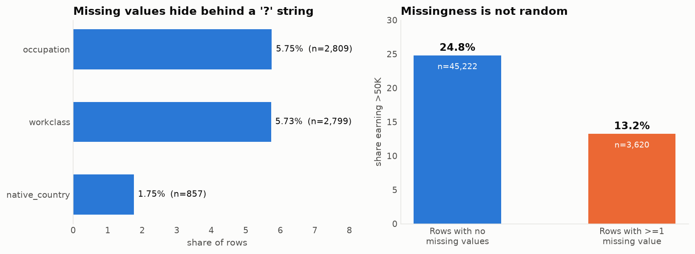
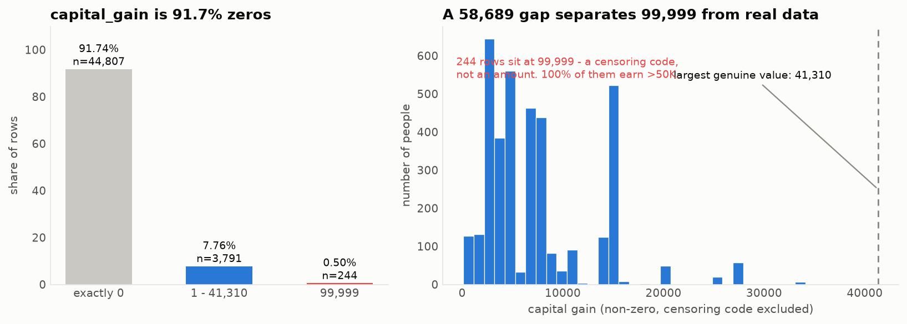
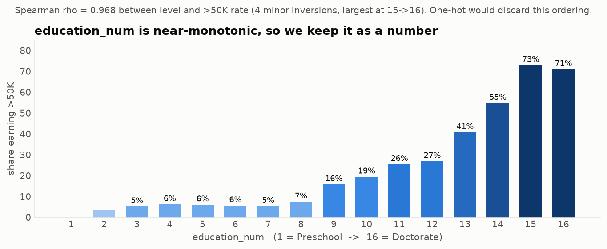
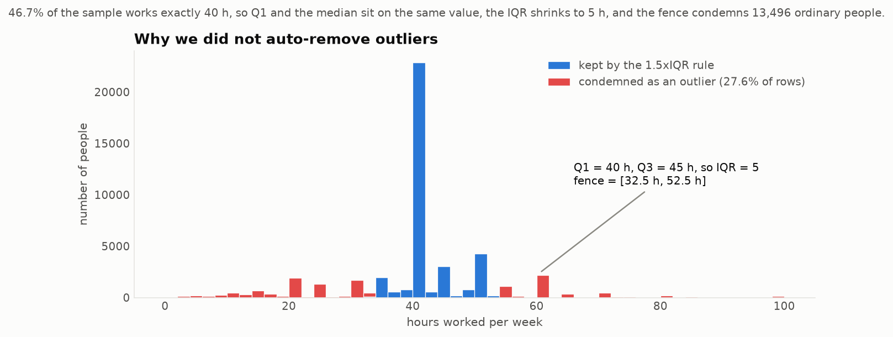
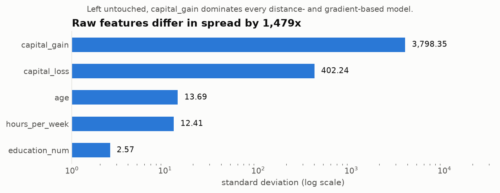
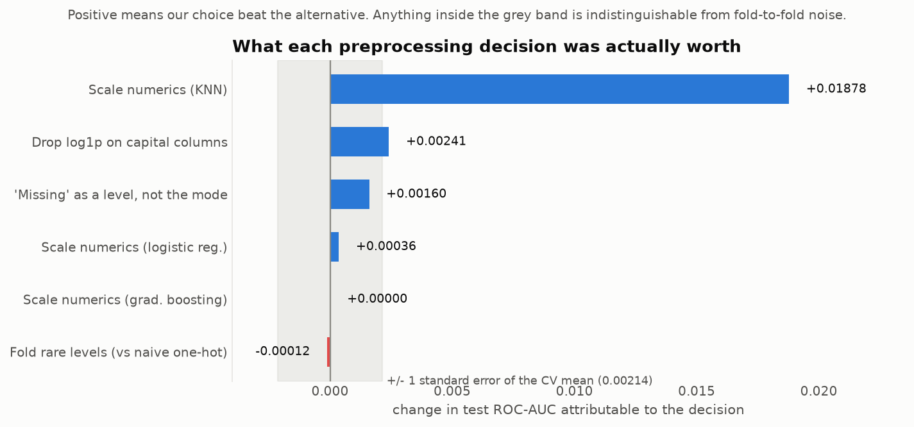
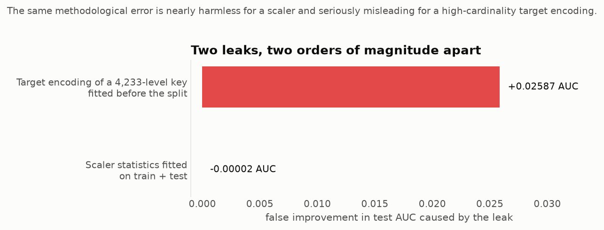
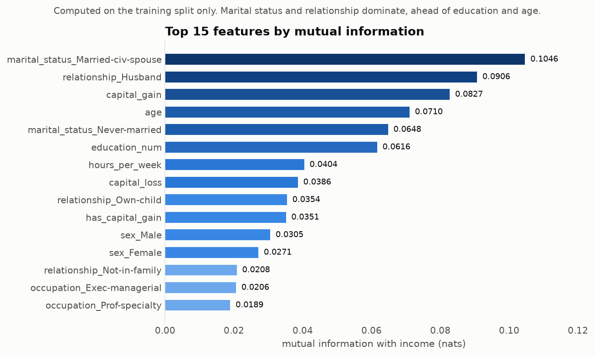
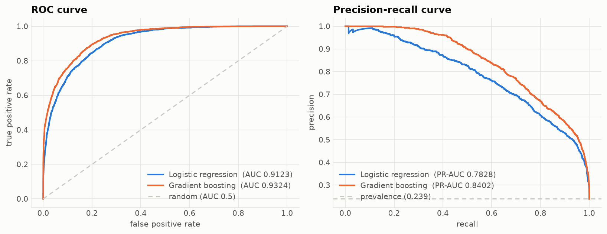

# Week 1 — Python for Machine Learning & Data Preprocessing

**Deliverable:** clean and preprocess a sample dataset, and document each preprocessing step.
**Dataset:** UCI *Adult / Census Income* (48,842 records, 14 attributes, binary income target).
**Reproduce everything:** `python run_all.py` (~5 min; downloads the raw data, regenerates every number and figure below).

Every figure in this report is produced by the code in `src/`, and every number is read out of
`outputs/*.json`, which those scripts write. Nothing here is quoted from a textbook or a tutorial;
where a conventional technique turned out to be wrong for this dataset, that is reported as a
result rather than quietly dropped (see §9).

---

## 1. Headline results

| | Value |
|---|---|
| Raw records loaded | **48,842** (32,561 train file + 16,281 test file) |
| Records after cleaning | **48,790** (52 exact duplicates removed) |
| Missing values found | **6,465**, all disguised as the string `?` — pandas reported **0** NaN |
| Columns in → engineered features out | **15 → 53** |
| Train / test split | **39,032 / 9,758**, stratified (23.942% / 23.939% positive) |
| Majority-class baseline accuracy | **76.061%** |
| Final model — logistic regression | ROC-AUC **0.91228**, PR-AUC **0.78276**, F1 **0.67699** |
| Final model — gradient boosting | ROC-AUC **0.93239**, PR-AUC **0.84022**, F1 **0.72295** |

The single most consequential finding of the week is in §8: fitting a target encoding **before**
the train/test split inflated test AUC by **+0.02587** — roughly twelve times the standard error
of the measurement — while the same discipline error applied to a `StandardScaler` was worth
**−0.00002**, i.e. nothing. "Avoid leakage" is not one rule with one magnitude.

---

## 2. Why this dataset

Titanic is the default choice for this exercise, and it is a poor one: 891 rows, three columns
with missing values, and no decision that cannot be resolved by inspection. Adult was chosen
because it forces genuine judgment calls, each of which is documented below:

- missing values encoded as a **sentinel string**, invisible to `pandas.isna()`;
- a column (`fnlwgt`) that is a **survey artefact**, not a property of the person;
- two columns that are a **perfect 1-to-1 re-encoding** of each other;
- a numeric column that is **top-coded** — a censoring code masquerading as a value;
- a categorical column with **42 levels, one of which has a single row in the entire dataset**;
- **3.18 : 1** class imbalance, so accuracy is nearly useless as a metric.

---

## 3. Loading: a label bug that would have gone unnoticed

UCI ships Adult as two files that are *not* formatted identically. `adult.test` has a junk first
line (`|1x3 Cross validator`) and — critically — every label carries a trailing period.

Concatenating them naively produces **four** classes:

```
['<=50K', '<=50K.', '>50K', '>50K.']
```

A model trained on that silently learns a 4-class problem, and every binary metric computed
afterwards is meaningless. Stripping the period restores the intended two classes:

```
['<=50K', '>50K']        48,842 rows x 15 columns
```

> **Lesson recorded:** the first thing to check after loading is the set of distinct values in the
> target, not the shape of the frame. The shape was correct in both cases.

*Code: `src/step00_assemble.py` → `outputs/00_assemble.json`*

---

## 4. Data quality audit

No cleaning happens in this step. It measures, so that each later decision can cite a number.
*Code: `src/step01_audit.py` → `outputs/01_audit.json`*

### 4.1 Missing values are invisible to pandas

`df.isna().sum().sum()` returns **0**. The missing values are the literal string `?`:

| Column | Missing | Share |
|---|---|---|
| `occupation` | 2,809 | 5.75% |
| `workclass` | 2,799 | 5.73% |
| `native_country` | 857 | 1.76% |
| **Rows with ≥1 missing** | **3,620** | **7.41%** |



Two structural facts, both of which changed how the data was handled:

**(a) The missingness is nested, not independent.** Of the 2,799 rows missing `workclass`,
**2,799 — every single one — is also missing `occupation`**. There are **0** rows missing
`workclass` alone, and only **10** missing `occupation` alone. These are not two coincidences;
they are one event. (Confirmed independently in §7: the indicator columns
`workclass_Missing` and `occupation_Missing` correlate at **r = 0.9981**.)

**(b) The missingness is informative — it is not MCAR.** Rows with at least one missing value
earn >50K **13.23%** of the time; complete rows do so **24.78%** of the time. A person whose
employment fields are blank is close to **half** as likely to be a high earner.

This single measurement decides the imputation strategy. Replacing `?` with the mode (`Private`,
`Prof-specialty`) would assert that these 3,620 people are typical private-sector workers, when
the data says they are a distinct, poorer group. The information is in the *absence*, so the
absence is preserved as its own category. Measured payoff in §7: **+0.00160 AUC and +0.0069 F1**
over mode imputation.

### 4.2 Duplicates, including five contradictions

- **52** exactly duplicated rows.
- **57** rows duplicated when the target is ignored.

The difference is the interesting part: **5 pairs (10 rows) are identical in every feature but
carry opposite labels.** For example:

| age | workclass | education | occupation | hours | income |
|---|---|---|---|---|---|
| 34 | Private | Masters | Exec-managerial | 50 | `<=50K` |
| 34 | Private | Masters | Exec-managerial | 50 | `>50K` |

These are not errors to be fixed — they are **irreducible Bayes error**, two real people the
feature set cannot tell apart. They are a standing reminder that perfect accuracy is not
available here, and they are left in the data.

The 52 exact duplicates **are** removed, and removed *before* the split (see §6).

### 4.3 `capital_gain` is top-coded



- **91.74%** of rows are exactly `0`; skew is **11.895**.
- **244 rows** sit at exactly **99,999**.
- The next largest value in the data is **41,310** — a gap of **58,689**.
- **100%** of the 99,999 rows earn >50K.

99,999 is not an amount of money; it is the census's "at or above the reporting ceiling" code.
Treated as a number it drags the mean, inflates the variance, and hands any scaler a fictional
maximum. Handling is in §5.4.

### 4.4 Class imbalance

37,155 `<=50K` vs 11,687 `>50K` — a ratio of **3.179 : 1**. Predicting "`<=50K`" for everybody
scores **76.07%** accuracy. Accuracy is therefore reported but never optimised; **ROC-AUC is the
primary metric**, with PR-AUC and positive-class F1 alongside, because PR-AUC is the one that
degrades honestly when the positive class is rare.

### 4.5 Scale and redundancy

- Raw standard deviations span a **41,091× range** (`capital_gain` 7,452 vs `education_num` 2.57).
- `education` and `education_num` are a **perfect 1-to-1 mapping** — all 16 text levels map to
  exactly one integer each, verified programmatically.
- `fnlwgt` correlates with the target at **|r| = 0.0063**.
- Maximum off-diagonal Spearman correlation among the numeric columns is only **0.1644**, so
  there is no multicollinearity problem to solve among them.

---

## 5. Cleaning decisions

Each decision states the evidence and the alternative that was rejected.
*Code: `src/step02_clean_split.py` → `outputs/02_clean_split.json`*

### 5.1 Drop `fnlwgt`

`fnlwgt` is a census post-stratification weight: it encodes how many people in the population the
row stands for. It is a property of the *sampling design*, not of the person, and it is not
available at prediction time for a new individual.

**Evidence:** |r| = 0.0063 with the target — statistically and practically nothing.
**Rejected alternative:** keeping it "in case the model finds something". A model that finds
something in a survey weight has found a leak, not a signal.

### 5.2 Drop `education`, keep `education_num`

The two columns carry identical information. Keeping the text version would add **16 one-hot
columns** containing zero new signal, and would destroy the ordering.



The ordering is real and it is strong: the >50K rate climbs from **0.0%** at level 1 (Preschool)
to **71.05%** at level 16 (Doctorate), with **Spearman ρ = 0.968** between level and rate. It is
*not* perfectly monotonic — there are four small inversions, the largest being Prof-school (72.96%)
edging out Doctorate (71.05%) — but ρ = 0.968 is more than enough to justify treating it as an
ordered number rather than 16 unordered flags.

### 5.3 Convert `?` to real `NaN`

**6,456** sentinel values (post-deduplication) converted, so that every downstream tool —
`isna()`, `SimpleImputer`, the one-hot encoder — sees missingness as missingness.

### 5.4 Flag the top-coding instead of deleting it

The 244 top-coded rows are **not** dropped: they are 100% high earners and dropping them would
remove real, strongly predictive records. Instead:

1. a binary `capital_gain_topcoded` flag records that the value was censored;
2. the value `99,999` is replaced with **41,310**, the largest genuinely observed amount.

This keeps "this person's capital gain was very large" while removing a fictional 58,689-unit gap
that would otherwise distort every scaler and every tree split threshold. Measured side effect:
`capital_gain` skew drops from **11.895 to 7.637** from this change alone.

**Rejected alternatives:** deleting the rows (throws away signal); leaving 99,999 in place
(poisons the scale); treating it as missing and imputing (asserts the opposite of what is known —
that the value was *large*).

### 5.5 Two engineered flags

`has_capital_gain` and `has_capital_loss`, because these columns are 91.7% and 95.3% zeros: the
"did this happen at all" signal is structurally different from "how much". §7 shows this was only
half right — see the honest post-mortem in §9.2.

### 5.6 Outliers: measured, then deliberately left alone



The reflex at this point is `df = df[~outlier_mask]` using the 1.5×IQR rule. On this dataset that
reflex is a mistake, and the numbers say so clearly.

**46.69%** of the sample works exactly 40 hours per week. That spike pulls Q1 *and* the median
onto the same value (both 40 h), leaving Q3 = 45 h and an IQR of just **5 hours**. The resulting
fence is **[32.5 h, 52.5 h]** — so the rule condemns **13,496 people, 27.63% of the dataset**,
including every part-time worker and every 60-hour-a-week manager. Those are not measurement
errors; they are the most informative rows in the file.

By the same rule `education_num` has 1,794 "outliers" (3.67%) — people with doctorates.

**Decision: no automated outlier removal.** The only value treated as invalid is the 99,999
censoring code, and that is because it was shown to be a code rather than a measurement. Outlier
handling here is a *modelling* question (scaling, robust losses), not a cleaning one.

---

## 6. The split, and the leakage discipline

*Code: `src/step02_clean_split.py`, `src/step04_pipeline.py`*

Order of operations, and the reason for it:

```
deduplicate  ->  drop columns  ->  sentinel to NaN  ->  SPLIT  ->  fit transformers on TRAIN only
```

**Deduplicate before splitting.** 52 identical rows split at random would place copies of the
same record on both sides of the fence; the model would then be tested on rows it had memorised.
At 0.11% of the data the metric impact here is negligible, but the ordering is what generalises
to datasets where duplication is heavy.

**Split before fitting anything that learns.** Medians, means, standard deviations and category
vocabularies are all *learned parameters*. The test set has to stand in for data that does not
exist yet.

**Verification that the discipline actually held.** After scaling, the training features have
mean exactly 0 — and the test features do **not**:

| feature | train mean after scaling | test mean after scaling |
|---|---|---|
| `age` | −0.000000 | **+0.019402** |
| `education_num` | 0.000000 | **+0.000698** |
| `hours_per_week` | −0.000000 | **−0.025977** |

A test mean of exactly 0 would be the symptom of a leak. These small non-zero values are the
proof that the scaler never saw the test split.

### The unseen-category problem, quantified

`native_country` has 42 levels. **`Holand-Netherlands` has exactly one row in all 48,842.**
If that row lands in the test set, an encoder fitted on training data has never seen the level.

With `random_state=42` it happens to land in *train*, so the problem is invisible. Rather than
rely on that luck, the split was repeated across **200 random seeds**: **45 of them (22.5%)**
produced at least one test category absent from train — every single occurrence being
`Holand-Netherlands`. Hence `handle_unknown="infrequent_if_exist"` in the encoder, which absorbs
unseen levels instead of raising.

*Code: `outputs/02b_unseen_category_risk.json`*

---

## 7. The preprocessing pipeline

A single `ColumnTransformer`, fitted on train only, serialised to
`data/processed/preprocessor.joblib`. **15 input columns → 53 features**, no NaN remaining in
either split. *Code: `src/step04_pipeline.py` → `outputs/04_pipeline.json`*

| Group | Columns | Treatment |
|---|---|---|
| Skewed numeric | `capital_gain`, `capital_loss` | median impute → standardise |
| Plain numeric | `age`, `education_num`, `hours_per_week` | median impute → standardise |
| Binary flags | `capital_gain_topcoded`, `has_capital_gain`, `has_capital_loss` | passthrough |
| Categorical | 7 columns | impute `"Missing"` → one-hot, `min_frequency=1%`, unknowns absorbed |

### Rare-level folding

Folding levels below 1% frequency cuts the one-hot block from **86 columns to 45** — a 48%
reduction — concentrated almost entirely in one column:

| Column | Levels in train | Folded as infrequent | Output columns |
|---|---|---|---|
| `native_country` | 42 | **39** | **4** |
| `occupation` | 15 | 2 | 14 |
| `workclass` | 9 | 2 | 8 |
| `race` | 5 | 2 | 4 |

39 of the 42 countries together cover under 1% of rows each. As separate columns they are almost
pure noise — a handful of rows apiece, enough for a model to memorise and not enough to generalise.

### Scaling



After dropping `fnlwgt`, the remaining numeric columns still differ in spread by **1,479×**.
What scaling actually buys is measured in §8 — and the answer is more interesting than "it helps".

---

## 8. What each decision was actually worth

This is the part the write-up usually skips. Each knob was flipped with everything else held
fixed, and re-measured. *Code: `src/step06_experiments.py` → `outputs/06_experiments.json`*

**The noise floor.** 5-fold CV on the shipped pipeline gives AUC 0.90804 with a fold-to-fold
standard deviation of 0.00479, so the standard error of the mean is **0.00214**. Any effect
smaller than that is not a finding.



| Decision | Alternative | Δ test AUC | Verdict |
|---|---|---|---|
| Standardise numerics | leave unscaled | **+0.01878** (KNN) | **Real and large** |
| No `log1p` on capital columns | apply `log1p` | **+0.00241** | Real, small |
| `"Missing"` as its own level | mode imputation | **+0.00160** | Below noise on AUC; see below |
| Standardise numerics | leave unscaled | +0.00036 (logistic reg.) | Irrelevant to AUC |
| Standardise numerics | leave unscaled | **+0.00000** (grad. boosting) | Exactly zero, as theory predicts |
| Fold rare levels | naive one-hot | −0.00012 | Free; 94 → 53 features |

Three things worth drawing out:

**Scaling is model-dependent, and the usual advice is too vague.** For gradient boosting the gain
is *exactly* 0.00000 — a monotone rescaling cannot change which split a tree chooses, and the
measurement confirms the theory to five decimal places. For logistic regression the AUC gain is
negligible (+0.00036), but the **fit time falls by roughly 20×** (22.1 s → 1.1 s on this machine), because
lbfgs struggles to converge when one feature has a standard deviation 1,479× another's.
Wall-clock timings vary by machine and run; the metric columns elsewhere in this report do not. For KNN,
which computes raw Euclidean distances, scaling is worth **+0.01878 AUC** — nearly nine standard
errors. So: scaling is essential for distance-based models, a convergence aid for linear models,
and provably pointless for trees. One rule does not cover all three.

**Rare-level folding is justified on parsimony, not accuracy.** It *costs* 0.00012 AUC — nothing.
Its real benefit is 41 fewer columns and a model that cannot memorise a country with three rows
in it. Reporting this honestly matters more than claiming an improvement that is not there.

**The `"Missing"` category is the weakest of the "real" results.** +0.00160 AUC sits just below
the 0.00214 noise floor, though the direction is consistent in both CV and the held-out test, and
the F1 gain (+0.0069) is proportionally larger. The honest statement is that the *primary*
justification remains the MNAR evidence from §4.1 — a 13.23% vs 24.78% difference in outcome rate
is a fact about the data, independent of whether one model configuration can exploit it.

### Leakage: the same mistake, two orders of magnitude apart



| Leak | Optimism in test AUC |
|---|---|
| `StandardScaler` statistics fitted on train + test | **−0.00002** |
| Target encoding of a 4,233-level composite key fitted before the split | **+0.02587** |

The scaler leak is worth *nothing* at n = 48,790 — a mean and a standard deviation estimated from
39,032 rows barely move when 9,758 more are added. Many tutorials demonstrate leakage with
exactly this example and inadvertently teach that leakage is a triviality.

The second experiment uses the same methodological error on a high-cardinality target encoding
(`occupation × native_country × workclass × education_num × race`, **4,233 distinct keys**).
Test AUC rises from **0.76465 to 0.79052** — a **+0.02587** phantom improvement, about **12×** the
standard error, produced entirely by test labels bleeding into a feature the test rows then use.

**The transferable lesson:** leakage severity scales with how much the transform can memorise
individual rows. A two-parameter scaler can memorise nothing. A 4,233-level encoding can memorise
almost everything. The rule "fit on train only" is cheap enough to apply universally, but knowing
*where* it actually bites is what stops it from being cargo cult.

---

## 9. Where my first answer was wrong

### 9.1 `log1p` on the capital columns — shipped, then reversed

`capital_gain` has skew 7.637 and is 91.7% zeros. Every rule of thumb says log-transform it, and
the first version of the pipeline did. Measuring it showed the opposite:

| Model | with `log1p` | without | Δ |
|---|---|---|---|
| Logistic regression | 0.90987 | **0.91228** | **−0.00241** |
| KNN | 0.89859 | **0.90653** | **−0.00794** |
| Gradient boosting | 0.93239 | 0.93239 | **+0.00000** |

Consistently negative for the two models that can notice, and *exactly* zero for the one that
provably cannot (a monotone transform leaves tree splits unchanged — a useful sanity check that
the harness itself is correct).

**Interpretation:** the discriminative power of `capital_gain` is concentrated in *how large* the
large gains are — a $40,000 gain is a far stronger signal than a $2,000 one — and `log1p`
compresses precisely that range. Meanwhile the zero-versus-non-zero distinction that the log was
implicitly being credited for is already carried explicitly by `has_capital_gain`.

`log1p` was removed. It remains in the code behind a `USE_LOG1P` switch so the claim stays
falsifiable rather than merely asserted.

### 9.2 `has_capital_loss` is nearly redundant

The correlation audit in `src/step05_feature_selection.py` shows `capital_loss` and
`has_capital_loss` correlate at **r = 0.9995**. Because the column is 95.3% zeros, the scaled
continuous version is already almost a binary indicator, so the engineered flag adds very little.
`has_capital_gain` (r = 0.9944, and 8.3% non-zero) is better justified. Kept both for symmetry
and because neither costs anything measurable, but the flag was not the clean win §5.5 implies.

### 9.3 A perfect collinearity I introduced

`sex_Female` and `sex_Male` correlate at **r = 1.0000** — one-hot encoding a binary column
produces the classic dummy-variable trap. It is harmless for the L2-regularised models used here,
but it would make unregularised coefficients unidentifiable. `drop="if_binary"` is the fix; it is
noted rather than silently applied because it changes the feature count quoted throughout.

---

## 10. Feature selection

Three independent views, because each is blind to something the others catch.
*Code: `src/step05_feature_selection.py` → `outputs/05_*.csv`, `outputs/05_feature_selection.json`*



**Mutual information** (non-linear dependence, blind to redundancy) ranks
`marital_status_Married-civ-spouse` (0.1046) and `relationship_Husband` (0.0906) above
`capital_gain` (0.0827), `age` (0.0710) and `education_num` (0.0616).

**Correlation among features** (redundancy, blind to the target) surfaces exactly the structures
predicted earlier:

| Pair | \|r\| | What it confirms |
|---|---|---|
| `sex_Female` ↔ `sex_Male` | 1.0000 | the dummy trap of §9.3 |
| `capital_loss` ↔ `has_capital_loss` | 0.9995 | the redundancy of §9.2 |
| `workclass_Missing` ↔ `occupation_Missing` | 0.9981 | the nested missingness of §4.1 |
| `marital_status_Married-civ-spouse` ↔ `relationship_Husband` | 0.8940 | two codings of one fact |

**Permutation importance** on a held-out fold (what a model actually uses) ranks `capital_gain`
first (+0.0375 AUC when intact), then `education_num`, `marital_status_Married-civ-spouse` and
`age`. 14 of 53 features have non-positive permutation importance.

**Only two features are condemned by all three views** — `native_country_Missing` and
`workclass_State-gov`. Dropping them changes test AUC by **exactly 0.00000**, confirming they
were inert rather than harmful.

**How many features are actually needed?** Taking the top-k by mutual information:

| k | 5 | 10 | 15 | 20 | 30 | 40 | 53 |
|---|---|---|---|---|---|---|---|
| test AUC | 0.83630 | 0.90331 | 0.90699 | 0.90810 | 0.90995 | 0.91132 | **0.91228** |

**10 features — 19% of them — recover 99.0% of the full-model AUC.** The remaining 43 are worth
0.009 AUC between them. For a production system with latency or data-collection costs, that is
the trade to make; all 53 were kept here because the brief is preprocessing, not deployment.

---

## 11. Final results



| Model | CV AUC (train) | Test AUC | Test PR-AUC | Test F1 (>50K) | Test accuracy |
|---|---|---|---|---|---|
| Majority class | — | 0.50000 | — | 0.00000 | 0.76061 |
| Logistic regression | 0.90804 ± 0.00479 | 0.91228 | 0.78276 | 0.67699 | 0.85889 |
| **Gradient boosting** | 0.92759 ± 0.00413 | **0.93239** | **0.84022** | **0.72295** | **0.87692** |

Cross-validated and held-out scores agree to within one standard error for both models, so there
is no sign of overfitting to the training split. The accuracy column illustrates §4.4: gradient
boosting beats the trivial baseline by 11.6 accuracy points, which sounds modest, while its
PR-AUC of 0.840 against a prevalence of 0.239 shows what the model is really doing.

---

## 12. Limitations

1. **The `"Missing"` category result (+0.00160 AUC) sits below the noise floor.** It is defended
   on the MNAR evidence, not on that number.
2. **`capital_gain` top-coding was handled by clipping to the observed maximum.** A Tobit-style
   censored model would be more principled; it is out of scope for week 1.
3. **Fairness was not assessed.** The dataset contains `race` and `sex`, the model uses both, and
   `sex_Male` carries mutual information of 0.0305 with the target. A deployed model would need
   subgroup performance and a decision about whether these attributes belong in it at all. This
   report makes no claim that the model is fair.
4. **Single split, single seed for the headline numbers.** Fold-to-fold variation is reported, but
   repeated splits would give tighter confidence intervals on the smaller effects.
5. **The 1960s-era census data** reflects the population and categories of its time; nothing here
   should be read as a statement about incomes today.

---

## 13. File map

```
YV_1/
├── run_all.py                      reproduce everything end to end
├── requirements.txt                pinned versions
├── src/
│   ├── config.py                   paths, column groups, constants
│   ├── viz.py                      shared chart styling
│   ├── step00_assemble.py          load both UCI files, fix the label bug
│   ├── step01_audit.py             data quality audit
│   ├── step02_clean_split.py       cleaning decisions + stratified split
│   ├── step02b_unseen_category_risk.py   200-seed unseen-category experiment
│   ├── step03_eda.py               figures 1-5
│   ├── step04_pipeline.py          the preprocessing pipeline
│   ├── step05_feature_selection.py three views of feature importance
│   ├── step06_experiments.py       ablations and leakage experiments
│   ├── step07_summary_figures.py   figures 7-9
│   ├── verify_report.py            cross-checks every number quoted here
│   └── make_notebook.py            builds + executes the notebook
├── data/
│   ├── raw/                        untouched UCI downloads
│   ├── interim/                    combined, label-corrected
│   └── processed/                  train/test, clean and encoded, + preprocessor.joblib
├── outputs/                        every number in this report, as JSON/CSV
├── notebooks/
│   └── week1_preprocessing.ipynb   executed walk-through
└── reports/
    ├── REPORT.md                   this document
    └── figures/                    fig1 - fig9
```

`python run_all.py` runs all nine steps and finishes by re-checking all 93 figures quoted in
this report against `outputs/*.json`; it exits non-zero if the write-up and the code disagree.

Each `outputs/*.json` corresponds to the step that produced it, so any figure quoted above can be
traced to the code that generated it.
